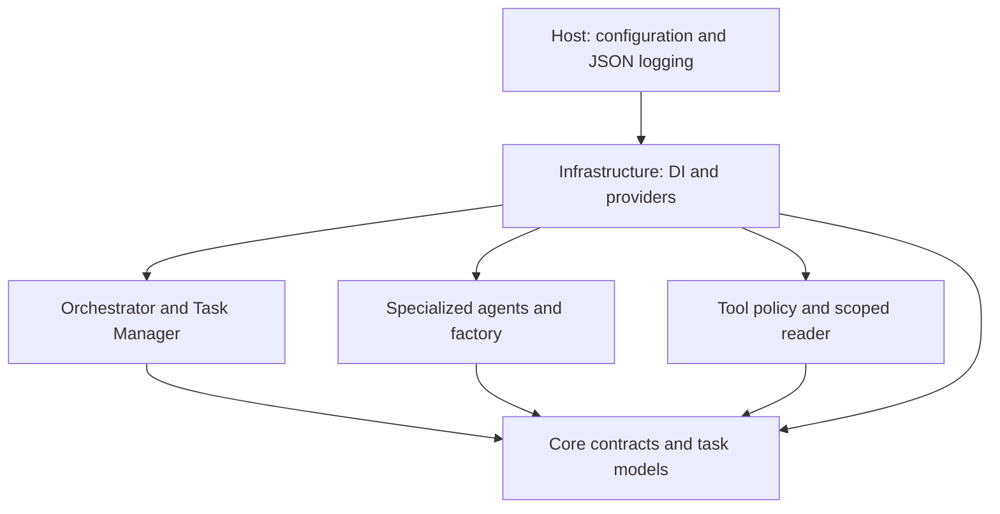

# AI Development Harness foundation

Status: Milestone 1 foundation, not an autonomous production development system.

Milestone 2 extends this foundation with a live-tested Codex Planner and a separate single-file proposal service. See [the current integration guide](codex-milestone2.md). The description below records the original milestone; its unavailable-execution statements remain true for the other five agent roles and original default workflow.

`AI-Harness/AI.GTX.Harness.slnx` contains the six foundation modules. The earlier three-project prototype was initially preserved and subsequently removed at the user's request because the foundation does not reference it. No Billing implementation, additional Git repository, deployment or merge is part of this milestone.

Core has no framework or infrastructure dependency. Orchestrator references Core and Microsoft logging/options. Agents and Tools reference only Core. Infrastructure is the registration/composition boundary and references the modules. Host loads configuration and starts execution. Microsoft framework implementations provide hosting, DI, options validation and structured console logging; Channels and ConcurrentDictionary supply the process-local queue and task index. xUnit supplies testing. No custom service container, logging framework, configuration parser or test runner is introduced.

## Task lifecycle and dependencies

The task manager constructs six dependent work items, queues them and records Pending → Running → a terminal state. Results use Completed, Failed, Blocked, Canceled or NotConfigured. An explicitly submitted custom DAG is validated for unique IDs, known dependencies and cycles. Steps run sequentially in dependency order; independent branches may continue after another branch fails, but failed dependencies block descendants. There is no parallel agent execution.

Agent attempts are bounded by approved configuration (1–3). Only explicit transient failures are retried; permanent failures are sanitized and recorded. Backoff is a configurable fixed delay. Cancellation and elapsed-time limits use cooperative .NET cancellation; a future adapter must honor the token. No automatic replay of file mutations is supported. Task state and step results are process-local; restart loses the queue and results. Per-step Running events are logged; the task index exposes the task's Running state and terminal step results, not live per-step snapshots.

## Agents and providers

`IAgent`, `IAgentFactory`, `IAiModelProvider`, `IModelProviderResolver`, `IAgentOrchestrator` and `ITaskManager` define boundaries. Roles use string identifiers to allow future module-specific agents. A new role requires a trusted implementation registration, its maximum permission set and an approved configuration definition. Configuration cannot load arbitrary types or assemblies or exceed the registered role ceiling.

The six model-backed adapters contain role-specific assignments. They forward model/provider selection and prior completed results through contracts. The only registered provider is a deterministic placeholder. It returns NotConfigured, blocks downstream work and never uses network or credentials. An arbitrary generated string is insufficient to return Completed. There is no action loop or claim that code generation, testing or review agents are operational.

## Capability and approval design

Capabilities identify read/list, change proposals, .NET build/test, Git inspection and high-impact operations. The policy requires configured permission and approval for writes or execution; destructive operations, Git merges and production deployments are never automatically authorized. Initial role ceilings omit the latter capabilities entirely. Approval defaults to deny.

Only bounded read/list are implemented. Unsupported operations return `Executed=false`, with no approval prompt and no action. Milestone 2 must join policy, immutable reviewable changes, approval for a specific proposal, execution and audit in a single broker. Agents must not receive raw shell/file APIs. A build/test broker must accept structured allowlisted commands and require approval, because MSBuild and test code can execute arbitrary code under the current user. Git inspection must be scoped to the selected repository and protected against hooks, external diff drivers and inherited environment overrides.

The reader rejects rooted/traversing paths, alternate streams, protected credential filenames, `.git`, `.ssh` and existing symlinks/junctions. Reads are limited to 100 KB and lists to 200 entries, without recursion. These checks cannot defend against hostile concurrent filesystem changes or arbitrary secrets in otherwise permitted files. The workspace must be secret-free and controlled. Use an OS boundary before enabling untrusted build code.

## Security and logging

Structured logs use static templates with task IDs, registered roles, attempts and execution states. Exception messages, task contents and provider text are omitted. Results remain in process memory; no transcript is persisted by the new host. Credentials belong outside source control in process environment or a future OS/cloud secret store. The current host reads no API-key values. A real adapter must add credential redaction, request/response size limits, cancellation tests, transport tests and safe error classification before use.

## Extension to Billing and ERP

The harness contains no business entities, GST algorithms, invoice rendering, database access or notification clients. Billing's future multi-company boundaries and requirements are captured separately. The tool workspace defaults inside the harness output directory and is not a mount of Billing source. Future authorization to work on a business module must explicitly select that workspace and approve reviewed changes. No production deployment or Git merge is authorized by this foundation.
