# Milestone 2 — Codex-first planning and reviewed changes

Milestone 3 extends this with persisted approvals and a scoped development pipeline; see [its security assessment and live-execution blocker](development-milestone3.md). This document retains the Milestone 2 behavior and evidence.

## Compatibility assessment and execution evidence

Verified on Windows on 2026-11-15:

| Check | Observed result |
| --- | --- |
| System .NET SDK | 10.0.403 |
| Existing harness-local SDK | 11.0.100, used without installing/upgrading anything |
| Baseline Milestone 1 | 43 tests and startup/placeholder checks passed before changes |
| Codex CLI | `codex-cli 0.169.0-alpha.11.1` on PATH; an alpha version, not upgraded |
| Authentication | `codex login status`: Logged in using ChatGPT |
| Non-interactive operation | `codex exec --help` advertises stdin prompts, JSONL, output schema and final-message file |
| Restrictions | Help advertises read-only sandbox, isolated working directory, ephemeral sessions and ignoring user configuration |
| Command tools | Installed feature list supports disabling shell, unified exec, hooks, plugins/apps and other execution surfaces |
| Real execution | The .NET host's Planner completed a real Codex call with CLI exit 0, validated JSON and a completed workflow |

The actual smoke result is `docs/examples/codex-planner-smoke.json`: three dependent tasks for a greeting formatter, acceptance criteria, assumptions and open questions. Workflow ID: `dca0ccfa-4d59-4286-868c-e708f2420a51`. It completed in one attempt. No application source was modified. Codex uses the existing ChatGPT authentication and allowance; no separate OpenAI API key was requested. This is a local CLI client communicating with Codex's cloud service, not local/offline model inference.

Initial live tests returned valid plans but were conservatively rejected because the adapter treated a documented nonfatal item-level error as a prohibited tool event. Official event definitions distinguish those warnings from fatal stream errors. The corrected adapter tolerates nonfatal warning metadata, still rejects fatal errors/tool events, and requires `turn.completed` plus a semantically valid typed plan. Regression tests cover this distinction.

Sources checked alongside installed help:

- [Codex command reference](https://learn.chatgpt.com/docs/developer-commands?surface=cli)
- [Official Codex configuration schema](https://developers.openai.com/codex/config-schema.json)
- [Official SDK item definitions](https://github.com/openai/codex/blob/main/sdk/typescript/src/items.ts)
- [Official SDK event definitions](https://github.com/openai/codex/blob/main/sdk/typescript/src/events.ts)

## Architecture and workflow

Core adds `ICodexExecutionProvider`, typed provider errors, plan/task models and semantic validation. Infrastructure implements the CLI adapter and `IAiModelProvider` bridge. The existing Planner now interprets validated structured plans; the other role adapters retain their original unavailable behavior. The existing task manager exposes `EnqueuePlan` to queue a one-step workflow. The existing orchestrator supplies lifecycle, dependency validation, cancellation and bounded retries; it now carries plan/error data in step results. No second workflow engine or service container was introduced.

```mermaid
flowchart LR
    Goal[User goal] --> Queue[Existing Task Manager]
    Queue --> Orchestrator[Existing Orchestrator]
    Orchestrator --> Factory[Existing Dynamic Factory]
    Factory --> Planner[Planner Agent]
    Planner --> Bridge[IAiModelProvider bridge]
    Bridge --> Provider[ICodexExecutionProvider]
    Provider --> Runner[Controlled process runner]
    Runner --> Codex[Codex exec: read-only, no shell tools]
    Codex --> Validation[JSON and semantic plan validation]
    Validation --> Review[Reviewable plan; no task execution]
```



The plan contract requires title, goal, tasks, assumptions and questions. Every task requires an ID, known role, description, dependencies and nonempty acceptance criteria. Validation rejects missing/unknown properties, empty fields, duplicate or invalid IDs, unknown dependencies, cycles, and size/count violations. A plan is a proposal; model assumptions are not approved business rules.

## Provider configuration and usage

Run from `AI-Harness` using the existing local SDK, or an explicitly installed SDK matching `global.json`:

```powershell
./.dotnet/dotnet.exe run --project src/AI.GTX.Harness.Host -c Release -- --codex-check
./.dotnet/dotnet.exe run --project src/AI.GTX.Harness.Host -c Release -- --plan 'Plan a small non-business sample with tests'
```

`config/codex.json` sets executable name, execution timeout, planning model and attempt limit. `Codex:WorkspaceRoot` defaults to an absolute temporary `AI-GTX-Harness/codex` directory. Each probe or plan receives a newly created GUID child directory. It contains no application source and inherits no project configuration from this repository. Codex authentication remains in the user's existing Codex credential storage; the harness never opens that storage.

Environment overrides use the existing `GTX_` prefix, for example:

```powershell
$env:GTX_Codex__Executable = 'C:/approved/path/codex.exe'
$env:GTX_Codex__TimeoutSeconds = '240'
$env:GTX_Planning__Model = 'default' # omit --model and use the CLI default
$env:GTX_Planning__MaxAttempts = '2'
```

An executable name is resolved from PATH; on Windows only a native `.exe` is accepted. No `.cmd`, PowerShell launcher, shell expansion, install or upgrade is invoked. Availability probes check required flags/features and insist on ChatGPT login; API-key login is not silently substituted. `--plan` locates the configured planner role, overlays its Codex provider/model/attempts and uses a 600-second outer workflow bound. Configured roles and permission ceilings still pass through the existing factory; disabled roles stay disabled. Other roles cannot execute through this provider.

If the CLI is missing, incompatible, unauthenticated or inaccessible in the current process environment, `--codex-check` returns 4 and no inference is started. In the Codex desktop tool sandbox this machine initially could not resolve the CLI home directory; ordinary host execution outside that sandbox verified login. Do not weaken the sandbox or switch authentication to hide such a failure. Run from the user's normal authenticated terminal, or correct supported CLI environment configuration explicitly.

Exit codes remain 0 for completed/self-check, 1 for failed/blocked, 2 for cancellation and 4 for unavailable/not-configured. A declined change proposal returns 3. Step output includes typed errors. A self-check validates DI/configuration only; `--codex-check` verifies provider availability and `--plan` demonstrates actual execution.

## Process and permission model

The process runner uses `ProcessStartInfo.ArgumentList`, redirected stdin/stdout/stderr, no shell and no window. Goals go through stdin, not command-line interpolation. Capture is bounded to one million characters per stream. Timeout/cancellation kill the child process tree. The adapter permits only fixed probe commands and a fixed `exec` template. It exposes no arbitrary command API to agents.

Execution requests read-only sandboxing and `--ask-for-approval never`: the latter prevents interactive escalation and does not bypass sandbox denials. Dangerous full-access, approval-bypass, automatic approval, extra writable directories, trust-persistence, pushes, merges and deployment flags are never used. User configuration is ignored for this invocation while cached authentication is retained. Command execution, unified exec, hooks, plugins/apps, computer/browser tools, image generation and multi-agent/code-mode execution features are explicitly disabled. Web search is disabled. Existing user/project exec rules are not bypassed. No global settings are changed.

The adapter rejects observed command/file-change/MCP and unknown item events. These checks detect protocol violations after the fact; prevention relies on the CLI's disabled capabilities and sandbox. This is not an OS/container boundary against a malicious CLI executable or administrator changing the filesystem concurrently. Only approved trusted executables/workspace roots should be configured. Read-only sandboxing alone is not a filesystem read-isolation guarantee. No source snapshot is given to this initial Planner; it plans from the submitted goal only.

API-key/access-token environment variables are removed from child processes, and ChatGPT login is forced. Other inherited environment variables remain. Known credential values and common credential/token patterns are redacted from captured diagnostics and prompts. Logs omit raw prompts, streams, plans, provider bodies and exception messages; they record typed outcomes/exit codes. Redaction cannot identify every arbitrary secret: never put credentials or real customer data in goals. Plans are displayed to the requesting user and retained as review artifacts, not logged as telemetry. CLI authentication metadata is outside the harness's control.

## Reviewable change proposal slice

The change proposal service is separate from Codex. It accepts a user-supplied candidate, stages it outside the target workspace, and renders a full-file diff. Nothing applies automatically and the generated plan is not executed.

```powershell
# Use a dedicated disposable change workspace first. These settings are explicit trusted scope.
$env:GTX_Changes__Workspace = 'D:/approved-scratch-workspace'
$env:GTX_Changes__Staging = 'D:/separate-scratch-proposals'
./.dotnet/dotnet.exe run --project src/AI.GTX.Harness.Host -c Release -- --propose 'sample.txt' 'D:/candidate/sample.txt'
```

The command displays target path, proposed diff and SHA256, then requires `APPLY <exact content hash>`. Any other input or EOF declines. Approval is specific to that in-memory proposal ID/path/content. Target and staging roots must be separate. Traversal, rooted paths, streams, protected paths, Windows aliases and existing links are rejected. Both staging content and the original target hash are rechecked at application time. Stale/tampered proposals cannot apply. An existing target is held exclusively while checking and writing; new files use `CreateNew`. No shell commands run, and no Git repository is initialized.

This is a small single-file working slice, not a production patch engine. It writes UTF-8 and shows text/newline changes; candidate bytes are identified by SHA256. It does not implement binary files, deletion, multi-file atomicity, crash-safe transactions, persistent approvals, identity verification, rollback or hostile concurrent filesystem protection. In-process proposals cannot be resumed after restart; staged candidates remain for inspection. Test approvals use disposable temporary workspaces only. No business source change was applied during implementation.

## Verification and known limitations

```powershell
./verify-milestone2.ps1                 # build, all repeatable tests, baseline and startup checks
./verify-milestone2.ps1 -RunCodexSmoke  # additionally verify login and make an explicit live Planner request
```

Live requests consume the account's Codex allowance and are opt-in, not part of unit tests. Mocked tests cover compatibility/authentication, typed failures, malformed plans, dangerous events, task lifecycle, retries, workspace restrictions, approvals, stale/tampered proposals and redaction. A trusted test-only child executable checks real process IO, timeouts, cancellation and output bounds without model-generated shell code. The original 43 Milestone 1 tests remain unchanged.

The installed CLI is an alpha, and its path/protocol can change during desktop updates. Capability checks fail closed, but only the observed version has live evidence. Windows is the verified platform. Queue/results and proposal registrations are process-local; temporary run/staging artifacts require user-managed retention. There is no active Developer/Tester/Reviewer execution, repository understanding, background daemon, unattended change application, billing functionality, push, merge or deployment.

Recommended Milestone 3: explicitly approved source snapshots, typed Developer change proposals tied to a plan, a durable review/approval record, isolated allowlisted build/test execution with observed evidence, and a Reviewer checkpoint on a small non-business sample before authorizing Billing work.
