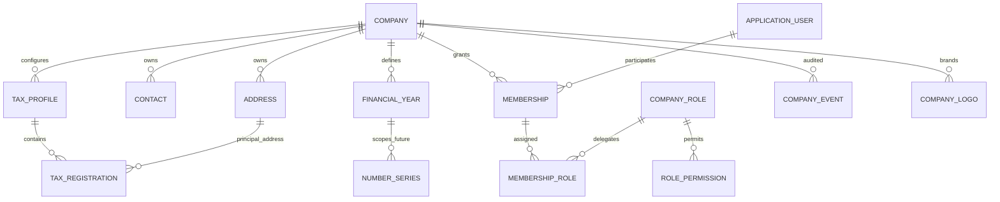

# B1 logical database schema proposal

Status: provider-neutral logical design, **not runnable DDL or an approved migration**. Shared SQL Server is the proposed initial mapping; UUID → uniqueidentifier, Unicode text → bounded nvarchar, date-only → date, UTC instants → datetimeoffset, and Version → positive bigint are candidate physical choices. PostgreSQL or separate-database adoption needs explicit alternative migrations/policies. Do not use Access file storage as an unexamined production isolation layer.

## Key and concurrency conventions

- `Company(CompanyId)` is the root. Every tenant-owned child has **NOT NULL CompanyId**.
- A tenant-owned entity's primary key is `(CompanyId, EntityId)`; UUID EntityId alone is never a relational or authorization scope. Every tenant-to-tenant FK repeats CompanyId.
- Global reference catalogues and global login identities are explicit exceptions, not implicitly shared business masters. Customer, product and future invoice data will be company-owned by default.
- All mutable aggregates have server-set CreatedAtUtc, CreatedByActorId, UpdatedAtUtc, UpdatedByActorId and Version. Use atomic compare-and-update on expected Version, incremented by the server. Child changes also advance the Company aggregate Version while edited through the Company form.
- No tenant-owned cascade delete is proposed. Inactivate/end-date instead. Explicit lifecycle procedures preserve referenced legal records.
- Normalize company/series codes using approved ordinal rules. Database unique indexes must use equivalent comparison semantics; collation differences are integration-test cases.

## Core identity and company tables

| Table | Key and essential columns | Constraints / relationships |
| --- | --- | --- |
| Security.ApplicationUser | UserId UUID; Issuer 300, Subject 200, DisplayName 200, Status, Version, audit fields | PK UserId; unique `(Issuer, Subject)`; no passwords/tokens in Company tables. An email is not an identity key |
| Security.PlatformAdministrationSlot | SlotId=1, PrimaryAdminUserId, Version | PK/check SlotId=1; FK UserId. Exactly one assigned active Super Admin when the deployment is operational; atomic transfer/recovery process protects the last administrator |
| Company.Company | CompanyId UUID, Code/NormalizedCode 20, LegalName 200, DisplayName nullable 200, BusinessTypeCode nullable 40, RegisteredCountryCode nullable 2, BaseCurrencyCode nullable 3, Status, DefaultFinancialYearId nullable, Version/audit | PK CompanyId; unique NormalizedCode (including inactive rows); references country/currency/business-type catalogues; activation enforces required nullable draft fields |
| Company.CompanyTaxProfile | CompanyId, JurisdictionCode, DeclaredRegistrationStatus, PANNormalized nullable 10, IECNormalized nullable 40, Version/audit | PK `(CompanyId, JurisdictionCode)`; FK CompanyId. Indian profile validators apply only to explicitly supported kinds |
| Company.CompanyTaxRegistration | CompanyId, TaxRegistrationId UUID, JurisdictionCode, Kind, Identifier/NormalizedIdentifier 40, StateCode nullable, PrincipalAddressId, Status, EffectiveFrom, EffectiveTo nullable, VerificationState/Method/At/By, Version/audit | PK `(CompanyId, TaxRegistrationId)`; FK `(CompanyId, JurisdictionCode)` → profile; FK `(CompanyId, PrincipalAddressId)` → address; unique `(CompanyId, JurisdictionCode, Kind, NormalizedIdentifier)` |
| Company.CompanyAddress | CompanyId, AddressId UUID, Type, address fields, CountryCode, StateCode nullable, PostalCode nullable, IsPrimaryForType, EffectiveFrom/To, Version/audit | PK `(CompanyId, AddressId)`; country/state relationship references approved `(CountryCode, StateCode)` catalogue when applicable; one current primary per Company/Type |
| Company.CompanyContact | CompanyId, ContactId UUID, Name, Designation nullable, Email nullable, Phone nullable, Extension nullable, PreferredChannel, IsPrimary, Status, Version/audit | PK `(CompanyId, ContactId)`; require at least one contact channel for usable contact; one current primary per company; duplicate contact channels allowed |
| Company.CompanyIndustry | CompanyId, IndustryCode | PK `(CompanyId, IndustryCode)`; global approved classification reference; no tax behavior inferred from tags |
| Company.CompanyLogo | CompanyId, LogoId UUID, Slot, PrivateStorageKey, MediaType, ByteLength, ContentHash, Width/Height, Version/audit | PK `(CompanyId, LogoId)`; unique `(CompanyId, Slot)`; CHECK Slot in (1,2); validated private company-scoped storage, no client-supplied storage path |

Reference catalogues: Country, StateRegion (composite country/state key), Currency, BusinessType, Industry, and Permission. Their provenance, update process, supported jurisdictions and licensing must be approved. They contain no company-specific configuration and are read-only to ordinary company administrators.

Do not globally constrain PAN to one Company without D01/D06 decisions. A public uniqueness error must not disclose which other company uses a tax identifier. Cross-company duplicate checks, if approved, occur only through a privileged review workflow.

The registration's principal address must belong to the same Company; jurisdiction/state consistency additionally requires domain validation in the transaction. A foreign key alone cannot validate all cross-row business meaning. Do not enforce one GSTIN per state or use company mailing-state as a substitute for registration-state rules.

## Access, financial years, numbering and audit

| Table | Key and essential columns | Constraints / relationships |
| --- | --- | --- |
| Security.CompanyMembership | CompanyId, MembershipId UUID, UserId UUID, Status, ValidFromUtc/ValidToUtc nullable, AuthorizationVersion, Version/audit | PK `(CompanyId, MembershipId)`; unique `(CompanyId, UserId)`; FK Company and global User. Membership alone does not imply every permission |
| Security.CompanyRole | CompanyId, RoleId UUID, Code, Name, Status, Version/audit | PK `(CompanyId, RoleId)`; unique `(CompanyId, Code)`; company role cannot grant platform Super Admin privileges |
| Security.MembershipRole | CompanyId, MembershipId, RoleId | PK all three; FKs `(CompanyId, MembershipId)` and `(CompanyId, RoleId)` prevent cross-company role assignment |
| Security.RolePermission | CompanyId, RoleId, PermissionCode | PK all three; composite role FK plus global permission-code FK; only delegated company permissions may be assigned |
| Company.FinancialYear | CompanyId, FinancialYearId UUID, Code/Label 40, StartDate, EndDate, State, Version/audit | PK `(CompanyId, FinancialYearId)`; unique `(CompanyId, Code)`; CHECK start ≤ end; serialize overlapping-period validation per company |
| Billing.InvoiceNumberSeries (future milestone) | CompanyId, SeriesId UUID, FinancialYearId, DocumentType, SeriesCode 20, Prefix/Suffix, NextValue bigint, Status, Version/audit | PK `(CompanyId, SeriesId)`; FK `(CompanyId, FinancialYearId)`; unique `(CompanyId, FinancialYearId, DocumentType, SeriesCode)`; positive counter, server-only mutation |
| Audit.CompanyEvent | CompanyId, EventId UUID, ActorKind/ActorId, Action, EntityType/Id, AggregateVersion, AtUtc, CorrelationId, Reason, redacted ChangeSummary | PK `(CompanyId, EventId)`; append-only application access; CompanyId never nullable; separate platform-event stream for non-company actions |
| Application.IdempotencyRecord | CompanyId, ActorId, OperationCode, KeyHash, RequestHash, ResourceId/ResultMetadata, ExpiresAtUtc | Composite unique key includes Company/Actor/Operation/KeyHash; same key with different payload is a conflict; bounded retention |

`Company.DefaultFinancialYearId` has composite FK `(CompanyId, DefaultFinancialYearId)` to FinancialYear. It may be NULL for Draft; create the Company first, add a valid year and set the default transactionally before activation. Do not create a cross-company default year. The same principle applies to future branch, warehouse, customer, product, tax-registration and document references.

Platform provisioning idempotency is separate because a new CompanyId is not yet known: key it by authenticated platform actor, create operation and key hash, then persist the assigned CompanyId with the completed request. Platform audit events must not appear in another company's business audit feed.

## Relationships

All company-owned relationships shown carry CompanyId in physical foreign keys. The diagram does not indicate globally accessible joins.

## Transaction and constraint details

1. Company creation: authorized platform operation, generated ID, reserved normalized code, Draft profile, initial Company Administrator membership/role, provisioning idempotency receipt and audit event commit together in the proposed shared database. Failure rolls the entire operation back. No externally visible Active company with missing access configuration.
2. Aggregate update: validate expected Version, membership/permission/status and all child ownership; apply intended fields, bump Version and insert redacted audit event atomically. Identity-provider invitations/object storage are external operations; use pending state and an outbox where needed, not an assumed distributed transaction.
3. Primary address/contact replacement: clear old/set new in one serialized company transaction; a filtered unique index is a provider-specific backstop. Effective-date overlaps/current-primary semantics need consistent application and DB tests; a date-dependent CHECK using current time is not a safe universal solution.
4. Financial-year creation/update: enforce no inclusive date overlaps under concurrency using a per-company transaction lock/serializable equivalent plus provider-appropriate constraints. Merely checking in the UI or an unlocked query is insufficient.
5. Audit access: normal app credentials can append through the approved path, not alter/delete history. Owner/migration/backup credentials are separate. Decide retention, archival and restoration with D09; a table called append-only is not tamper-proof against DB administrators.
6. Indexes: company-leading indexes for status/name searches, memberships by UserId/status, scoped child FKs, financial-year range checks and audit `(CompanyId, AtUtc, EventId)`. Use bounded/paged queries; no unbounded company export.

## Future invoice and branch safeguards

The numbering table is a proposal for the invoicing milestone, not B1 CRUD implementation. Document creation will use explicit CompanyId, FinancialYearId, issuer registration and series. Composite FKs must prevent mixing any of those across companies. Add a unique issued-document key on `(CompanyId, FinancialYearId, DocumentType, FinalNumber)` plus any broader uniqueness required by the approved numbering rules.

Allocate a sequence using an atomic database operation in the document transaction with bounded conflict handling; never use MAX(number)+1 or a client-supplied next counter. Define idempotent issue/conversion, series changes, concurrent servers, cancellations and failures before implementation. Do not promise gapless numbering or reuse a number after an issued document without an approved policy. GST/document-number legal restrictions need separate authoritative validation; no character limit/reset rule is assumed by this draft.

Future Branch and Warehouse tables use `(CompanyId, BranchId)` and `(CompanyId, WarehouseId)` keys. Warehouse → Branch is a composite same-company FK. Future series may have a branch assignment, while SeriesCode remains unique within company/year/type; do not use nullable BranchId inside a primary key. Add branch permissions and registration assignments only with reviewed migrations. Physical stock, manufacturing and accounting tables are not part of B1.

## Access workflow and migration prerequisites

Treat Access as an unverified existing workflow, not a configured backend. Obtain a sanitized schema/relationship/query/report inventory, row counts, representative exports, old company identifiers, code/PAN/GSTIN duplicates and numbering examples before designing an import adapter. No credentials or real customer data should enter source control.

Propose one-way staged imports with a company-scoped source-ID map, validation/quarantine, dry-run reconciliation totals, source backup and a signed-off cutover. Do not dual-write Access and a new database without a separate conflict/recovery design. Choose the authoritative writer during transition. Access provider limitations and database-file access cannot be assumed to meet the proposed server RLS model.
